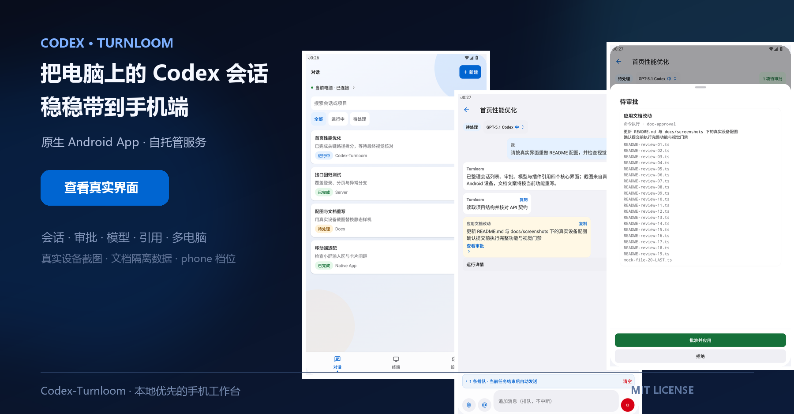
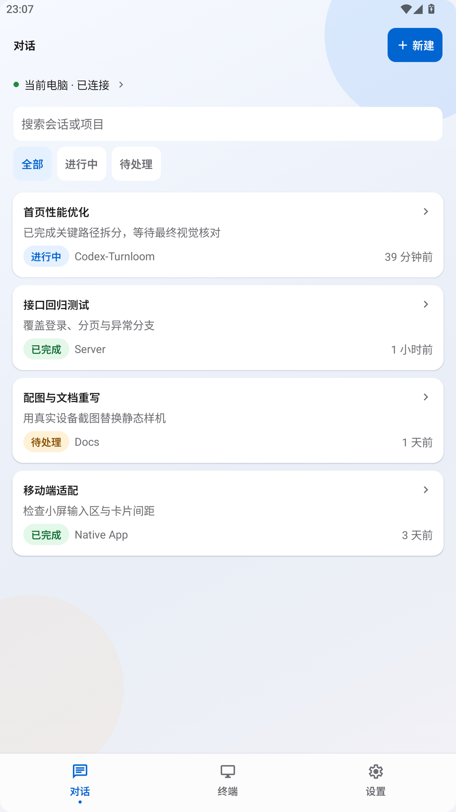
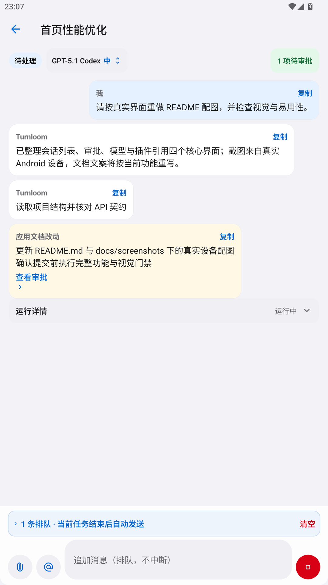
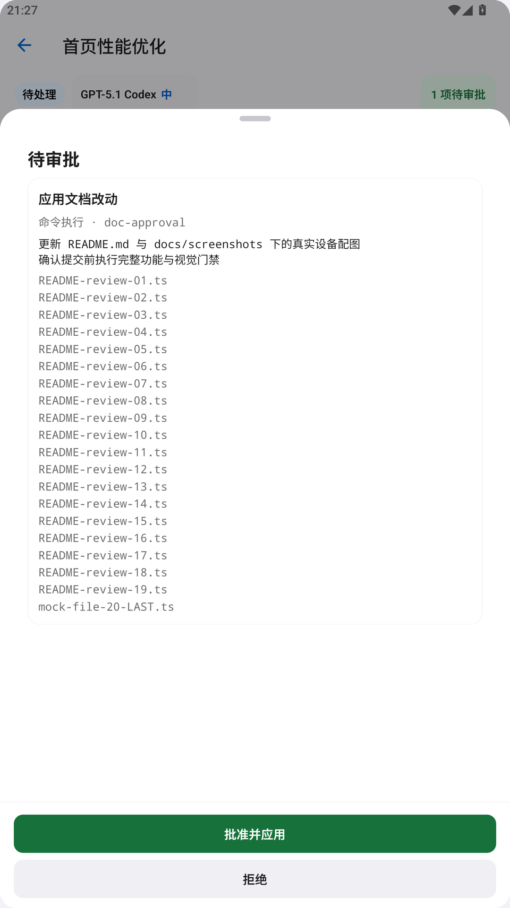
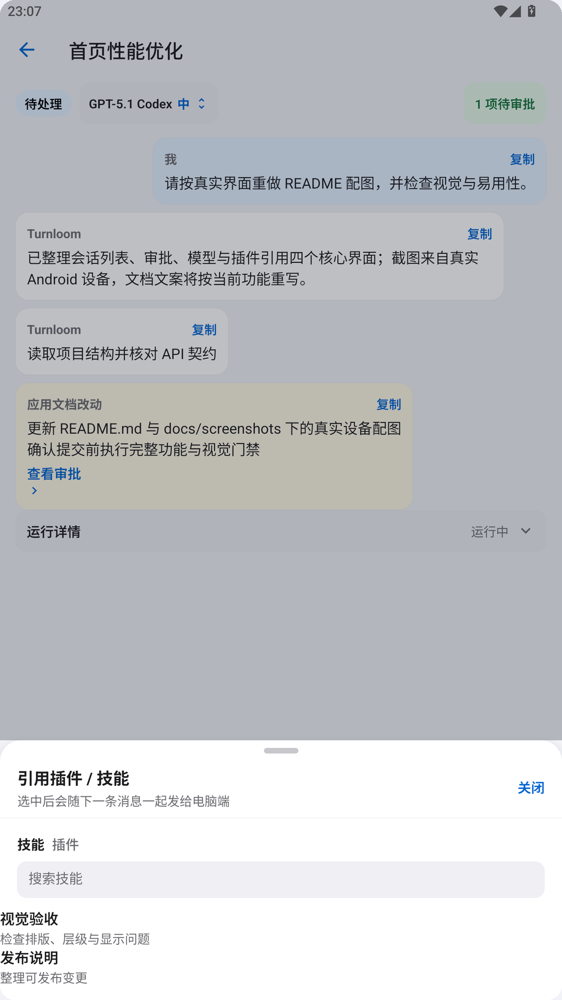
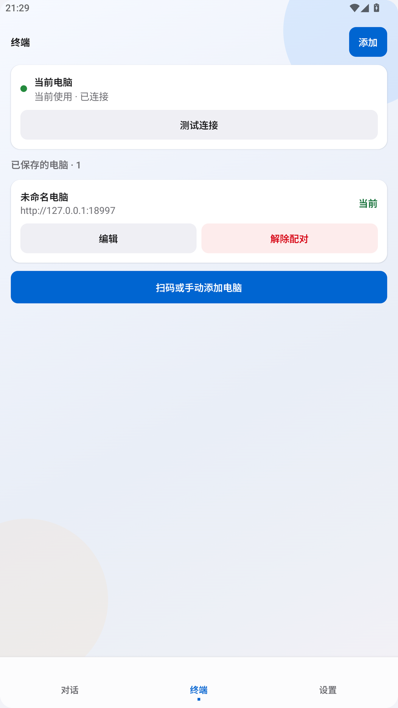
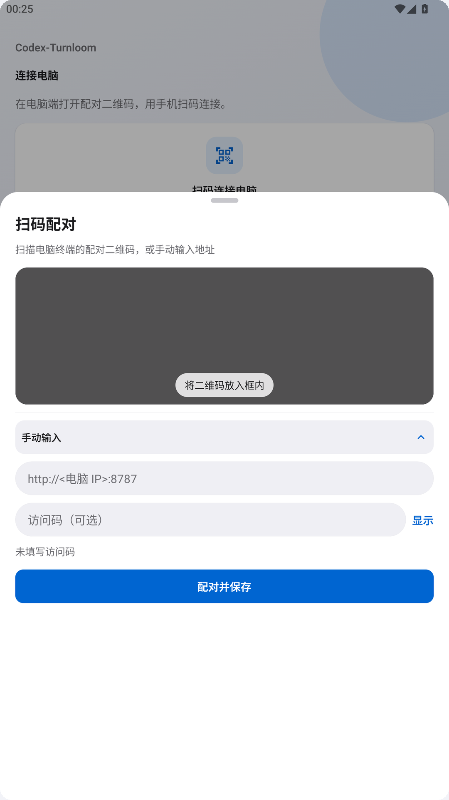

# Codex-Turnloom

<p align="center">
  
</p>

<p align="center">
  <strong>自托管、本地优先的 Codex 手机工作台</strong><br />
  在电脑上运行服务，手机用原生 Android App 查看会话、继续对话、处理审批。
</p>

<p align="center">
  <a href="https://github.com/736368217/Codex-Turnloom/actions/workflows/ci.yml"></a>
  <a href="https://github.com/736368217/Codex-Turnloom/releases/latest"></a>
  <a href="LICENSE"></a>
</p>

---

## 它解决什么问题

Codex Desktop 的会话、项目目录和运行记录都在电脑上。Codex-Turnloom 在 **电脑本机** 启动一个受访问码保护的 HTTP 服务，手机通过局域网连接该服务，查看、发送、审批等操作由电脑端代理完成；项目不提供云端账号或托管存储。

当前主线是 `mobile-app/` 下的 **Expo / React Native 原生 Android App**。`public/` 保留服务内置网页兼容入口，`desktop/` 是 Windows 托盘控制台，`android/` 是仓库现有的 Android 工程与 CI 检查入口。

> **安全边界**：项目按可信局域网设计。不要把服务直接暴露到公网；需要远程访问时，请自行放在有访问控制与 TLS 的私有网络后。详见 [SECURITY.md](SECURITY.md)。

## 真实界面

下面全部是当前源码构建后在 **MuMu Android 手机档位** 运行的真实设备截图，不是静态设计稿。截图使用隔离的文档数据，不含真实访问码、二维码、账户或私人会话内容。

| 会话工作台 | 对话与审批 |
|:---:|:---:|
|  |  |
| 搜索、状态筛选、项目归属、运行状态一目了然 | 实时消息、运行状态、代码改动、排队发送、复制与停止 |
| **长审批固定操作区** | **模型与思考强度** |
|  |  |
| 20 项文件列表滚动到底后，「批准并应用 / 拒绝」仍可见 | 按会话选择模型与推理强度，并记住偏好 |
| **插件 / 技能引用** | **连接管理** |
|  |  |
| 插件接口异常不会掩盖技能列表，引用随消息发送 | 保存多台电脑、测试连接、编辑或解除配对 |
| **扫码 / 手动配对** | **真实数据说明** |
|  | 截图由隔离文档 fixture 驱动：配对抽屉优先扫码，手动输入可展开；服务地址、访问码与会话内容均为演示数据，图中不展示真实二维码或密钥。 |

## 主要能力

- **会话管理**：列表、搜索、状态筛选、项目分组、逐会话草稿与缓存隔离。
- **消息流**：历史消息、长轮询更新、排队 / 插队 / 取消、发送失败重试、中断当前任务。
- **审批**：真实服务审批数据驱动；长文件列表可滚动，批准 / 拒绝按钮固定可见。
- **模型配置**：从服务健康接口读取模型目录，逐会话保存模型与思考强度。
- **引用能力**：插件和技能分别读取；一侧接口失败不会清空另一侧列表。
- **附件与复制**：图片/文件选择、消息复制、引用标签；可选原生模块缺失时安全降级。
- **连接与安全**：二维码或手动配对、多电脑隔离、访问码鉴权、401 恢复、只读模式、登录失败限流。
- **客户端**：原生 Android App；服务端另提供兼容网页入口与 Windows 托盘控制台。

## 快速开始

### 1. 环境要求

- **Node.js 22.5+**（与根目录 `package.json` 的 `engines.node`、CI 的 Node 22.23.4 对齐）
- Windows / macOS / Linux 上可运行 Codex Desktop 的电脑
- Android 手机或模拟器，与电脑处于可达网络

### 2. 在电脑上启动服务

```bash
git clone https://github.com/736368217/Codex-Turnloom.git
cd Codex-Turnloom
npm ci
node server.js --host 0.0.0.0 --port 8787 --password "<自定义强访问码>"
```

健康检查：

```bash
curl http://127.0.0.1:8787/api/health
```

返回 JSON 中 `ok: true` 即表示服务已就绪。不要复用示例访问码；未指定 `--password` 时服务会生成临时访问码，并在交互式终端或控制台显示。

Windows 用户可用安装脚本注册后台服务并打印配对二维码：

```powershell
.\scripts\install-windows.ps1 -MachineName "<电脑名称>" -Password "<自定义强访问码>"
npm run device:qr
```

### 3. 安装 Android App

从 [Releases](https://github.com/736368217/Codex-Turnloom/releases/latest) 下载对应 APK 安装。仓库 CI 也会构建 `android/` 工程并上传 `codex-Turnloom-debug-apk` 工件。

> 发布包与从源码完整构建原生工程的说明，以 Release 页面和工程脚本为准；完整 `mobile-app/` release 构建依赖本机 Android SDK、NDK、CMake、Ninja 与 Expo 原生依赖。

### 4. 连接手机

打开 App →「终端」→ 扫码或手动输入：

| 字段 | 示例 |
|---|---|
| 服务地址 | `http://<电脑局域网 IP>:8787` |
| 访问码 | 启动服务时设置的 `--password` |

保存并测试连接后，回到「对话」即可看到电脑上的会话。也可以直接扫描服务生成的配对二维码。

## 项目结构

```text
server.js              本机服务：API、鉴权、会话读写、队列、审批、只读模式
mobile-app/            原生 Android App（Expo Router / React Native）
public/                服务内置网页兼容入口
desktop/               Windows 托盘控制台
android/               仓库 Android 工程与 CI 构建入口
backends/              HTTP 后端适配器
scripts/               安装、守护、二维码、CI 校验等工具
test/                  Node 回归测试
docs/                  使用说明与真实设备配图
```

## 开发与验证

根目录常用命令：

```bash
npm test
npm run check
npm run desktop:check
npm run verify:ci
```

`npm run verify:ci` 会额外用 CI 对应的 Node 22 运行测试，并检查测试汇总中的 `fail` / `cancelled` 是否为 0。

`mobile-app/` 常用命令：

```bash
cd mobile-app
npm run typecheck
npm test
```

GitHub Actions 的 `Verify` 工作流覆盖：

- Windows + Node 22.23.4：完整 Node 测试、语法检查、桌面端语法检查、PowerShell 脚本解析。
- Ubuntu + Java 17 + Android SDK：`android/gradlew testDebugUnitTest assembleDebug`。

接口契约与 HTTP 后端模式见：

- [HTTP 后端适配器](docs/HTTP_BACKEND.zh-CN.md)
- [状态适配说明](docs/ADAPTER_STATUS.zh-CN.md)
- [安全说明](SECURITY.md)

## 安全约定

- 默认只面向可信局域网；不要直接公网暴露服务。
- 始终启用访问码；不要在 README、Issue、截图或日志中公开访问码与二维码。
- 只读浏览场景可使用 `node server.js --readonly`。
- 服务能读取本机 Codex 会话、项目路径与用量信息；任何能访问服务并通过鉴权的客户端都能看到这些内容。
- 项目依赖 Codex Desktop 的本地文件与私有 IPC 行为，上游版本变化可能影响兼容性。

## 许可

[MIT](LICENSE)。项目最初基于 MIT 许可的 `dreamingboat/codex-lan-companion` 思路扩展。
