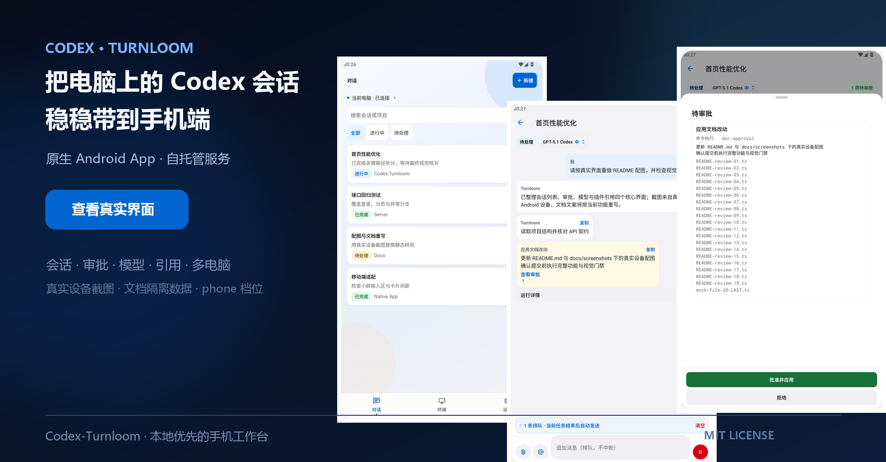

> ## 当前唯一交付线：`ROUTE=dom-shell`
>
> **App 化 DOM 容器（含 WebView）** = `app/`（React + Vite + TypeScript + Tailwind + **Konsta UI** +
> **Vaul** + Lucide + Framer Motion）→ `native-shell/` 独立 Android Java WebView 容器 →
> 可安装 APK（`com.codex.turnloom.app`，加载本地 `file:///android_asset/public/index.html`）。
> 唯一真源：[docs/option-a/SINGLE_APP_CONTRACT.md](docs/option-a/SINGLE_APP_CONTRACT.md)；
> 视觉规范 [UI_SPEC.md](docs/option-a/UI_SPEC.md)、架构 / 桥 / 交付
> [ARCHITECTURE.md](docs/option-a/ARCHITECTURE.md) / [BRIDGE.md](docs/option-a/BRIDGE.md) / [DELIVERY.md](docs/option-a/DELIVERY.md)。
>
> 诚实术语：App 化 DOM 容器（含 WebView）**≠ 纯原生**（纯 Kotlin/Compose）**≠ 非 WebView RN**
> **≠ 简单网页 / 远程 PWA**。可安装 APK、启动器图标、无浏览器 chrome、离线本地资源、
> 原生相机 / 触觉 / 安全存储桥、毛玻璃 TabBar、Vaul 手势抽屉、系统返回栈接管。
>
> **冻结 / 归档（不作为交付线）**：`mobile-app/`（旧 Expo/RN）、`public/`（远程 PWA）、`web-ui/`、
> `android/`（旧 WebView 壳）、`dshgo/`、`dist-dshgo/`、`dist-native/`、`feature/dshgo-rebase`。
> 旧 [Track A](docs/option-a/Track_A_Web_App_Upgrade_Spec.md) / [Track B](docs/option-a/Track_B_Native_Mobile_App_Spec.md)
> 双线规划已归档；共用后端 `server.js` / `backends/http-backend.js` 继续保留 `/api/*` 契约。
>
> 一机一码配对协议、后端 `/api/*` 契约、Windows 托盘控制台、Windows 无黑框 / 无可见控制台硬规则
> 均继续有效（见 [docs/PROTOCOL.zh-CN.md](docs/PROTOCOL.zh-CN.md) 与 AGENTS.md）。

# Codex-Turnloom

<p align="center">
  
</p>

<p align="center">
  <strong>自托管、本地优先的 Codex 手机工作台</strong><br />
  在电脑上运行服务，手机用 **ROUTE=dom-shell App 化 DOM 容器（含 WebView）** 查看会话、继续对话、处理审批（可安装 APK，非简单网页）。
</p>

<p align="center">
  <a href="https://github.com/736368217/Codex-Turnloom/actions/workflows/ci.yml"></a>
  <a href="https://github.com/736368217/Codex-Turnloom/releases/latest"></a>
  <a href="LICENSE"></a>
</p>

---

**2.4.0 / 99**：这一版按「用户什么时候会需要它」把三个页面重新过了一遍——设置页从 11 个可点项收敛到 8 行，诊断与关于各一个 sheet；会话搜索现在**同时搜标题、项目名与正文**（中文子串、英文大小写不敏感）；运行条拆成「N 运行中 · M 待你处理」，两个数与电脑端同源；对话页左侧按入口显示 `CX` / `PI` 头像；设备页每台电脑直接显示平台标记。同时修掉当晚报的「电脑 4 / 手机 2」：状态解析不再只看文件尾 512 KiB（长会话的 `task_started` 会被输出挤出窗口），静默等授权超过 10 分钟也不再被判成结束。安装 APK 时请同步升级电脑端服务（新增 `GET /api/search` 与 `/api/threads` 的 `active`）。见[本轮发布说明](docs/RELEASE_2_4_0_2026-11-21.md)。

## 它解决什么问题

Codex Desktop 的会话、项目目录和运行记录都在电脑上。Codex-Turnloom 在 **电脑本机** 启动一个受访问码保护的 HTTP 服务，手机通过局域网连接该服务，查看、发送、审批等操作由电脑端代理完成；项目不提供云端账号或托管存储。

当前唯一交付线是 `app/ + native-shell/` 的 **ROUTE=dom-shell App 化 DOM 容器（含 WebView）**（React + Konsta UI + Vaul → Android Java WebView 容器 → 可安装 APK）。`public/`（服务内置网页 / 远程 PWA）、`android/`（旧 Android WebView 兼容壳）、`mobile-app/`（旧 Expo/RN）、`web-ui/`、`dshgo/`、`dist-dshgo/`、`dist-native/` 均标注**冻结 / 归档**，保留只读兼容但不作为交付线。`desktop/` 是 Windows 托盘控制台，`server.js` / `backends/http-backend.js` 继续提供 `/api/*` 契约。

> **安全边界**：项目按可信局域网设计。不要把服务直接暴露到公网；需要远程访问时，请自行放在有访问控制与 TLS 的私有网络后。详见 [SECURITY.md](SECURITY.md)。

## 界面

当前交付线只有三个入口，底部 TabBar 就是全部导航：

| 页面 | 你在这里做什么 |
|---|---|
| **会话** | 打开就是最近会话；顶部一行「电脑 · 平台」回答「我在跟谁说话」；运行条列出正在跑的任务并就地停止；`按时间 / 按项目` 两个视图；搜索标题、项目名与消息正文。 |
| **设备** | 电脑 → 平台（Codex / PI-Desktop）→ 入口（harness）三层；当前电脑恒展开，非当前电脑只显示上次使用；扫码添加第二台电脑。 |
| **设置** | 字号、会话列表默认视图、触感反馈；诊断（运行信息 / 上传日志 / 清缓存 / 重新同步）与关于（版本行点即检查更新、更新日志、许可）各收进一个 sheet。 |

视觉契约是浅色 **Option A（Cupertino Daylight Glass）**：`#F2F2F7` 画布、白色分组卡、`#E5E5EA` 分隔线、毛玻璃顶栏/底栏、底部手势 sheet、44px 命中区、Lucide 单一图标族（尺寸 {14,16,20,22}、线宽 2）。细节见 [UI_SPEC.md](docs/option-a/UI_SPEC.md)。历史 Expo 客户端（`mobile-app/`）的截图仍留在 `docs/screenshots/`，但它们**不代表当前界面**。

## 主要能力

- **会话管理**：列表、状态筛选、项目分组、置顶、长按归档、逐会话草稿与缓存隔离。
- **搜索（2.4.0）**：`GET /api/search?q=` 同时命中标题、项目名与消息正文；中文按子串匹配，英文不区分大小写，`%` / `_` / 引号按字面量处理；标题与项目命中排在正文命中之前，结果带命中片段与 `took`。
- **排队（2.3.0）**：运行中发送即入队；抽屉里取回编辑、上移 / 下移 / 置顶、重试、删除；停止即暂停、可恢复；附件随队列持久化；PI 入口可「优先下一条」。
- **消息流**：历史消息、长轮询更新、发送失败重试、中断当前任务、图片与文件附件。
- **运行中可见（2.4.0）**：会话页顶部运行条分「N 运行中 · M 待你处理」两组，计数来自服务端 `active`，与分页无关；运行中可以就地停止，待处理的点「去处理」直接进会话。长会话与静默等授权不会再被误判成「已结束」。
- **审批**：真实服务审批数据驱动；长文件列表可滚动，批准 / 拒绝按钮固定可见。
- **模型配置**：从服务健康接口读取模型目录，逐会话保存模型与思考强度。
- **引用能力**：插件和技能分别读取；一侧接口失败不会清空另一侧列表。
- **多电脑与多入口**：一机一码配对，多台电脑各自隔离；同一台电脑上 Codex Desktop 与 PI-Desktop 是两个平台入口，可切换。
- **连接与安全**：二维码或手动配对、多电脑隔离、访问码鉴权、401 恢复、只读模式、登录失败限流。
- **客户端**：当前唯一交付线为 `ROUTE=dom-shell` **App 化 DOM 容器（含 WebView）**（React + Konsta UI + Vaul → Android WebView 容器 APK）。旧 Expo / React Native 客户端（`mobile-app/`）、远程 PWA（`public/`）、旧 WebView 壳（`android/`）、Flutter 实验线（`dshgo/` / `dist-dshgo/` / `dist-native/`）均已**冻结 / 归档**；纯 Kotlin/Compose 原生 App 本轮未采用，不得把当前容器假称纯原生。服务端保留兼容网页入口（归档）与 Windows 托盘控制台。

## 快速开始

### 1. 环境要求

- **Node.js 22.5+**（与根目录 `package.json` 的 `engines.node`、CI 的 Node 22.23.4 对齐）
- Windows / macOS / Linux 上可运行 Codex Desktop 的电脑
- Android 手机或模拟器，与电脑处于可达网络

### 2. 在电脑上启动服务

```bash
git clone https://github.com/736368217/Codex-Turnloom.git
cd Codex-Turnloom
npm ci
node server.js --host 0.0.0.0 --port 8787 --password "<自定义强访问码>"
```

健康检查：

```bash
curl http://127.0.0.1:8787/api/health
```

返回 JSON 中 `ok: true` 即表示服务已就绪。不要复用示例访问码；未指定 `--password` 时服务会生成临时访问码，并在交互式终端或控制台显示。

Windows 用户可用安装脚本注册后台服务并打印配对二维码：

```powershell
.\scripts\install-windows.ps1 -MachineName "<电脑名称>" -Password "<自定义强访问码>"
npm run device:qr
```

### 3. 安装 Android App

从 [Releases](https://github.com/736368217/Codex-Turnloom/releases/latest) 下载对应 APK 安装。当前唯一交付线的构建入口是 `scripts/build-single-app.ps1`（`app/` 的 npm ci/build + `native-shell/` Gradle + zipalign/sign），产物在 `dist-app/`；静态验收 `scripts/verify-single-app.mjs` 与 `node --test test/single-app-contract.test.cjs`。仓库 CI 的 `android/gradlew testDebugUnitTest assembleDebug` 属于**冻结归档的旧 WebView 兼容壳**检查，不是本轮 App 交付线。

> 发布包与从源码完整构建 APK 的说明，以 `docs/option-a/DELIVERY.md` 和 `scripts/build-single-app.ps1` 为准；完整构建依赖本机 Android SDK。旧 `mobile-app/` Expo 原生依赖说明已归档，不再是当前交付线依据。

### 4. 连接手机

首次打开 App →「连接电脑」→ 扫码，或点「输入地址和访问码」：

| 字段 | 示例 |
|---|---|
| 服务地址 | `http://<电脑局域网 IP>:8787` |
| 访问码 | 启动服务时设置的 `--password` |

保存并测试连接后，回到「对话」即可看到电脑上的会话。也可以直接扫描服务生成的配对二维码。

## 项目结构

```text
server.js              本机服务：/api/* API、鉴权、会话读写、队列、审批、只读模式（继续有效）
app/                   唯一 App UI 源码：React + Vite + Konsta UI + Vaul（ROUTE=dom-shell）
native-shell/          独立 Android Java WebView 容器（加载本地 assets/public/index.html）
dist-app/              最终产物：APK + SHA-256 + delivery.html + QA 报告
docs/option-a/         单线合同 / UI_SPEC / ARCHITECTURE / BRIDGE / DELIVERY（唯一真源）
scripts/               build-single-app.ps1 / verify-single-app.mjs / 安装·守护·二维码·CI 校验
test/                  Node 回归测试（含 single-app-contract.test.cjs）
desktop/               Windows 托盘控制台（继续有效）
backends/              HTTP 后端适配器（/api/* 契约，继续有效）
public/                服务内置网页 / 远程 PWA（冻结归档，非交付线）
mobile-app/            旧 Expo / RN 客户端（冻结归档，非交付线）
android/               旧 Android WebView 兼容壳（冻结归档，非交付线）
dist-native/ dist-dshgo/  旧 RN / Flutter 交付页与包（冻结归档，非交付线）
```

## 开发与验证

根目录常用命令：

```bash
npm test
npm run check
npm run desktop:check
npm run verify:ci
```

`npm run verify:ci` 会额外用 CI 对应的 Node 22 运行测试，并检查测试汇总中的 `fail` / `cancelled` 是否为 0。

`app/` 常用命令（当前唯一交付线）：

```bash
cd app
npm ci
npm run typecheck
npm run build
node --test ../test/single-app-contract.test.cjs
```

旧 `mobile-app/`（Expo / RN）命令已归档，不再作为交付线验证依据。

GitHub Actions 的 `Verify` 工作流覆盖：

- Windows + Node 22.23.4：完整 Node 测试、语法检查、桌面端语法检查、PowerShell 脚本解析。
- Ubuntu + Java 17 + Android SDK：`android/gradlew testDebugUnitTest assembleDebug`（**冻结归档的旧 WebView 壳 CI 检查，非本轮 App 交付线**；当前交付线构建见 `scripts/build-single-app.ps1`）。

接口契约与 HTTP 后端模式见：

- [HTTP 后端适配器](docs/HTTP_BACKEND.zh-CN.md)
- [状态适配说明](docs/ADAPTER_STATUS.zh-CN.md)
- [安全说明](SECURITY.md)

## 发布纪律

一个版本只有同时满足三条才算发完，缺一条就是「只存在于某台电脑上的构建」：

1. **在 `origin/main` 上**：本地提交必须已经推上去。
2. **有 tag 和 GitHub Release**：`v<version>`，附件是本版 APK、Windows 服务升级包，以及两者的 `.sha256`；Release 说明写 `docs/RELEASE_<version>_<date>.md`，与 CHANGELOG 同一口径。
3. **更新通道指向同一份包**：`latest.json` 的版本、大小、sha256 与 Release 附件一致。

一条命令走完并自检哈希：

```bash
npm run release -- --version 2.4.0 --notes docs/RELEASE_2_4_0_2026-11-21.md
```

脚本会先核对 `build.gradle.kts` 的 `versionName`/`versionCode` 与 `app/package.json` 是否一致、工作区是否干净、APK 与服务包是否存在，然后推 `main`、打 tag、建 Release，最后重新读回 Release 附件的 digest 与本地哈希比对——不一致就报错。任何一步失败都不要在 Main stream 宣布「已更新」。

`scripts/team/release-drift.ps1` 是这条规则的哨兵：每 30 分钟比对公网 `latest.json` 与最新 Release 的版本、APK 哈希与下载可达性，发现漂移才报一次（同一条漂移不重复报）。

## 安全约定

- 默认只面向可信局域网；不要直接公网暴露服务。
- 始终启用访问码；不要在 README、Issue、截图或日志中公开访问码与二维码。
- 只读浏览场景可使用 `node server.js --readonly`。
- 服务能读取本机 Codex 会话、项目路径与用量信息；任何能访问服务并通过鉴权的客户端都能看到这些内容。
- 项目依赖 Codex Desktop 的本地文件与私有 IPC 行为，上游版本变化可能影响兼容性。

## 许可

[MIT](LICENSE)。项目最初基于 MIT 许可的 `dreamingboat/codex-lan-companion` 思路扩展。
