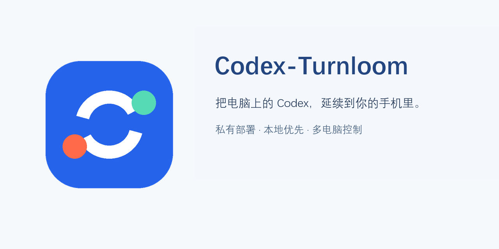
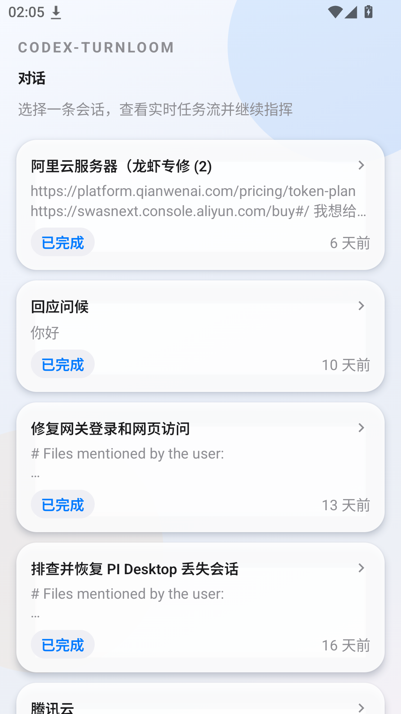
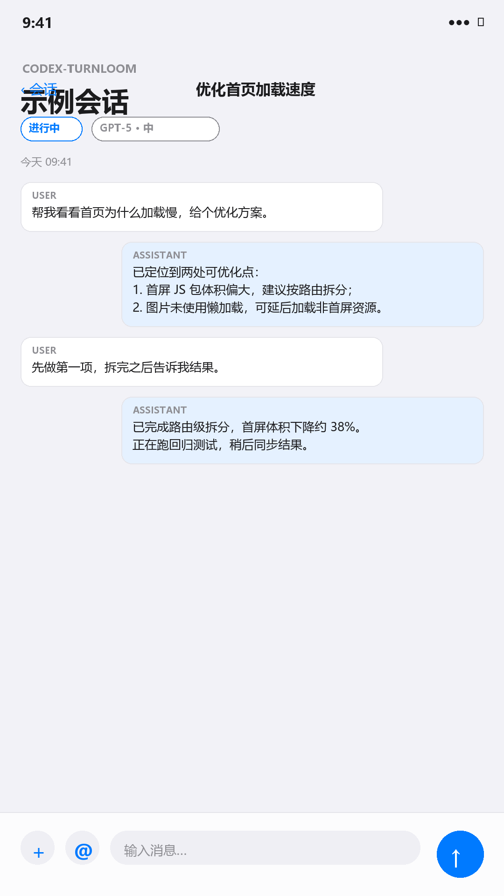
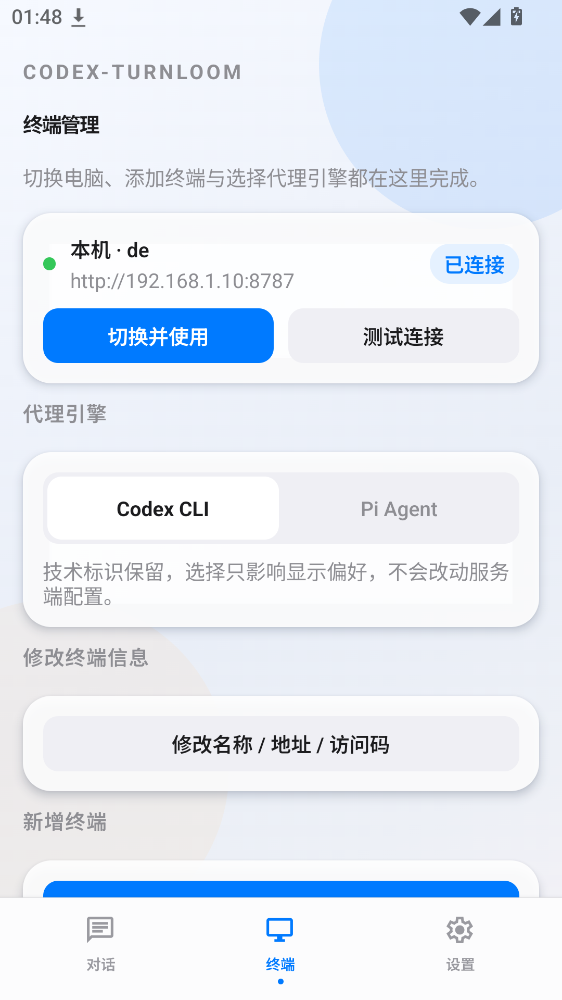
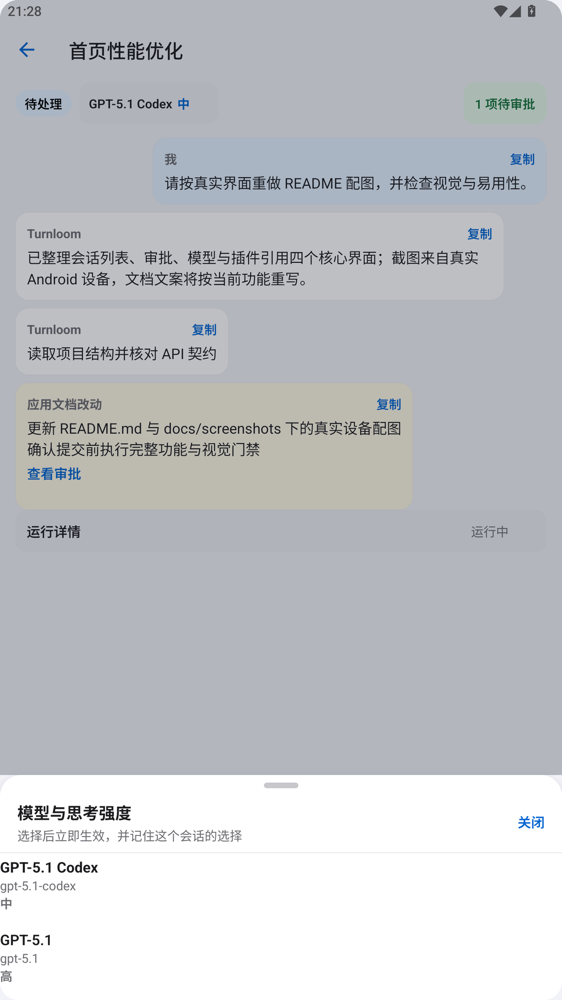

# Codex-Turnloom

<p align="center">
  
</p>

<p align="center">
  把电脑上的 Codex 会话，带到手机上继续。
</p>

<p align="center">
  <a href="https://github.com/736368217/Codex-Turnloom/releases/latest"></a>
  <a href="https://github.com/736368217/Codex-Turnloom/blob/main/LICENSE"></a>
</p>

**Codex-Turnloom** 是一个自托管的移动端工作台。在你的电脑上运行一个轻量的本地服务，手机装上 App，就能在局域网或公网查看会话、继续对话、处理审批——不需要远程桌面，对话和文件也不会离开你的电脑。

---

## 界面

| 会话列表 | 对话详情 |
|:---:|:---:|
|  |  |
| 搜索、状态、快速切换 | 全屏消息流、输入舱、发送 / 停止 |

| 终端管理 | 模型与思考强度 |
|:---:|:---:|
|  |  |
| 连接状态、服务地址、访问码 | 模型目录、逐会话记忆 |

更多功能与验收截图见 [发布说明](https://github.com/736368217/Codex-Turnloom/releases)。

---

## 功能

- **会话**：列表与搜索、实时消息流、运行状态、代码改动展示
- **发送**：文字与图片附件、排队 / 插队、中断、审批
- **配置**：模型与思考强度、插件 / 技能引用、新建会话归档到项目
- **连接**：二维码或手动配对、多电脑切换、访问码与登录会话
- **客户端**：原生 Android App（主线），另附可选网页入口

---

## 快速开始

### 1. 在电脑上启动服务

需要 Node.js 18+ 与 npm。

```bash
git clone https://github.com/736368217/Codex-Turnloom.git
cd Codex-Turnloom
npm ci
node server.js --host 0.0.0.0 --port 8787 --password <你的访问码>
```

浏览器打开 `http://127.0.0.1:8787/api/health` 返回 `{"ok":true,...}` 即表示服务就绪。

Windows 用户也可以用安装脚本把它注册为后台服务：

```powershell
.\scripts\install-windows.ps1 -MachineName "我的电脑" -Password "<你的访问码>"
npm run device:qr   # 打印配对二维码
```

### 2. 在手机上安装

从 [Releases](https://github.com/736368217/Codex-Turnloom/releases/latest) 下载 `Codex-Turnloom-Native.apk` 安装即可。旧设备或模拟器可选用 `Codex-Turnloom-Native-universal.apk`。

### 3. 连接

打开 App，在「终端」页填写：

| 字段 | 值 |
|---|---|
| 服务地址 | `http://<电脑 IP>:8787` |
| 访问码 | 第 1 步设置的密码 |

保存后回到「对话」，即可看到电脑上的会话列表。也可以直接扫描服务生成的配对二维码。

---

## 项目结构

```
server.js       本机服务：API、鉴权、会话读写、队列、审批
mobile-app/     原生 Android App（Expo / React Native）
public/         网页入口与静态资源
desktop/        Windows 托盘控制台
scripts/        安装、守护、二维码等工具
test/           回归测试
docs/           文档与交付报告
```

## 开发

```bash
npm test
npm run check
```

协议说明见 [HTTP 后端适配器](docs/HTTP_BACKEND.zh-CN.md)、[桥接约定](docs/PI_BRIDGE_CONTRACT.zh-CN.md)。

## 安全

- 所有数据留在你的电脑，服务端不做云端存储
- 访问码鉴权；公网使用请置于 HTTPS 反向代理之后
- 访问码在 Android 端加密保存

## 许可

[MIT](LICENSE) · 最初基于 MIT 许可的 `dreamingboat/codex-lan-companion` 扩展。
