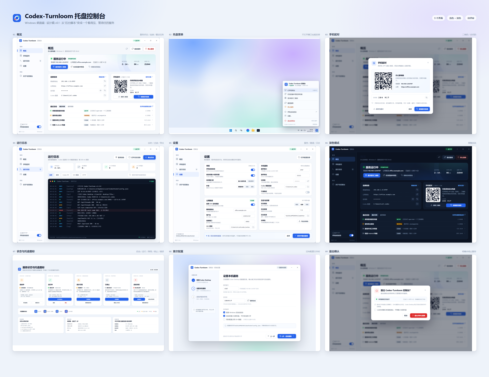
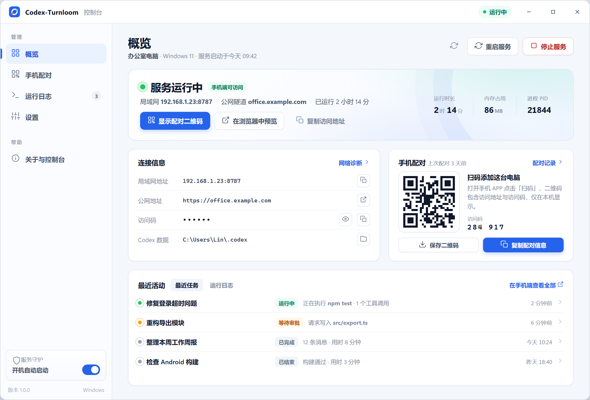
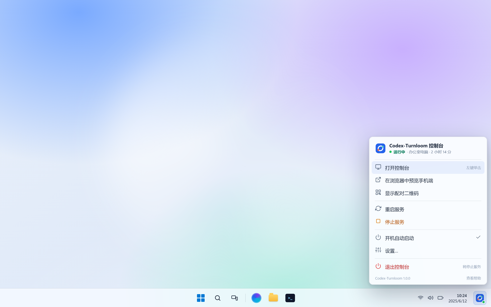
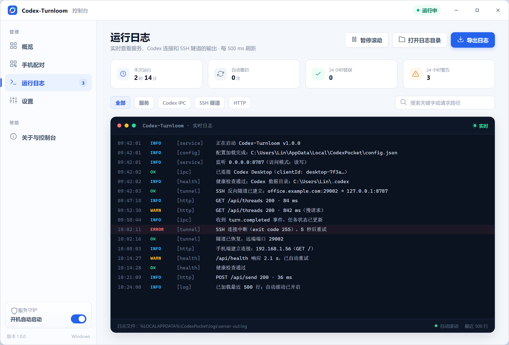
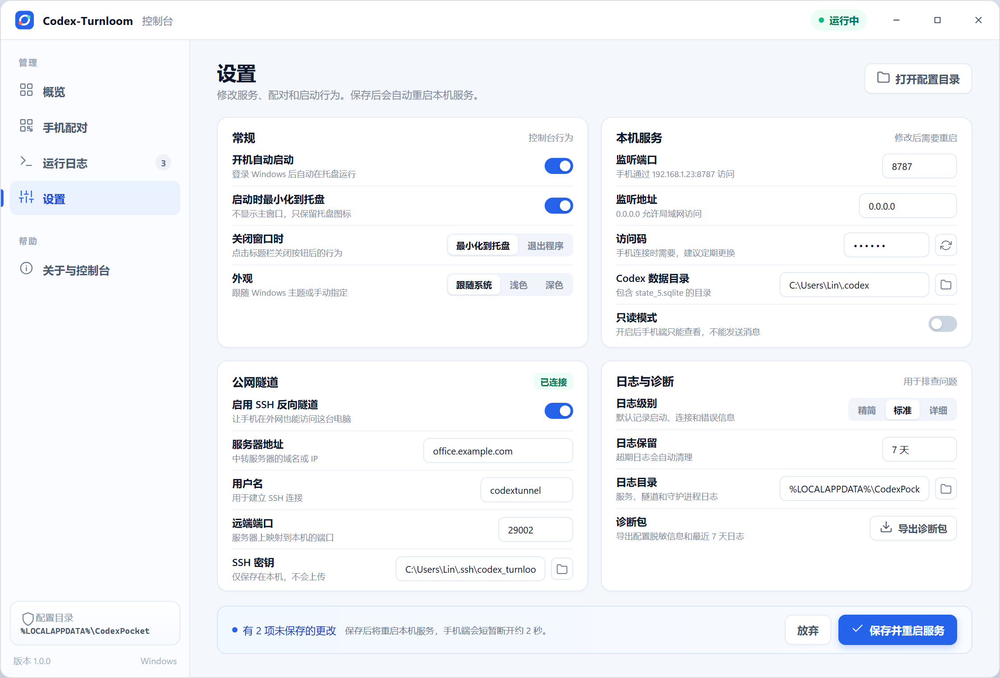
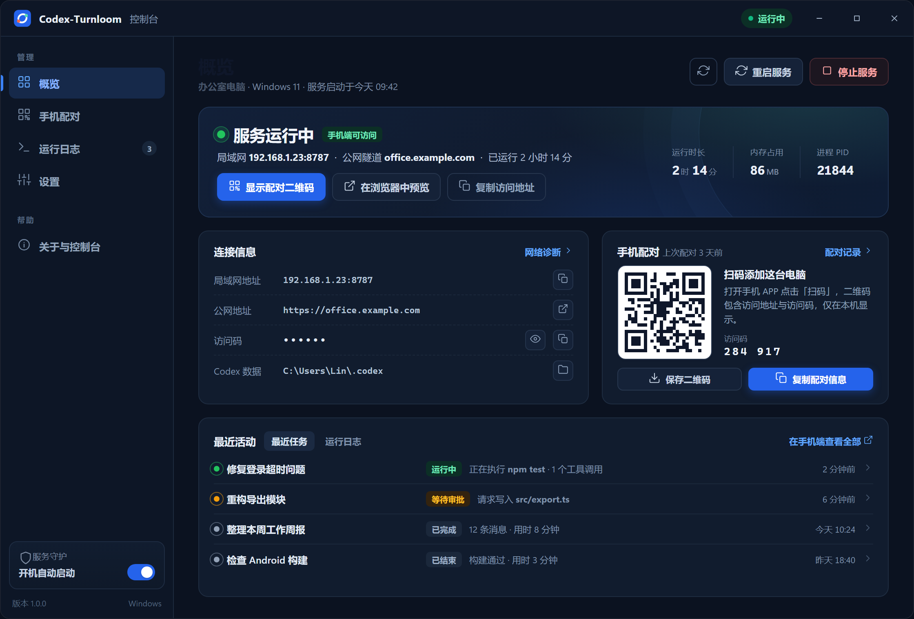
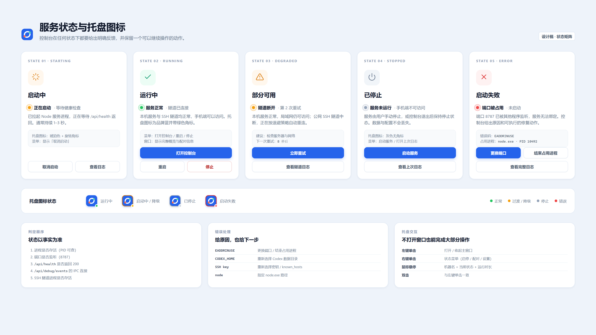
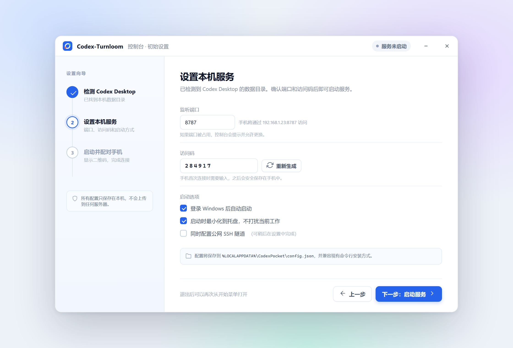
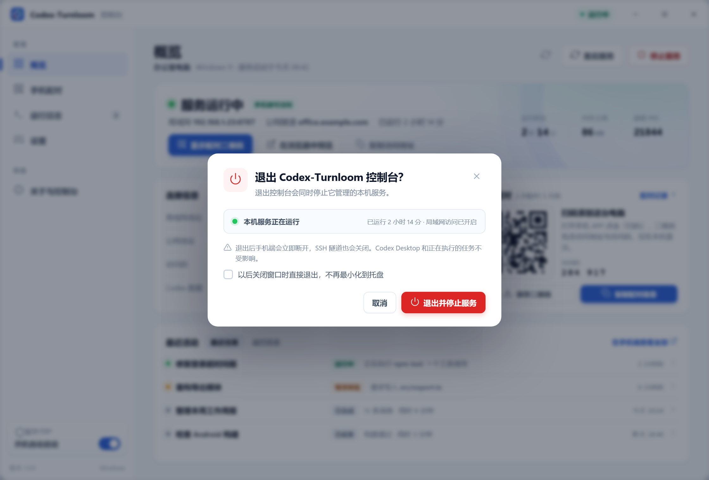

# Codex-Turnloom 托盘控制台 · 设计稿

> 版本：v0.2（待评审，已修正主操作语义）
> 范围：Windows 桌面端托盘应用，不改动手机端协议与 Codex Desktop 本身  
> 视觉稿：`docs/assets/tray-console/`，可编辑源文件：`docs/design/tray-console/`
> 修订 v0.2：修正桌面端主操作语义。主按钮由“打开手机端”改为“显示配对二维码”，次按钮明确为“在浏览器中预览”（预览手机网页，而不是打开手机）；同时补充真实 API 限制、二维码协议和性能基线。

---

## 0. 一页结论

做一个 **Codex-Turnloom 控制台**：Windows 登录后静默启动，只驻留系统托盘；左键打开主窗口查看状态，右键菜单直接启停服务、显示配对二维码、打开日志和设置。

核心变化不是“再加一个界面”，而是把现在藏在计划任务里的 PowerShell 守护逻辑，收进一个有明确状态、可手动控制、可诊断的桌面应用：

- **看得见**：服务、Codex Desktop 连接、SSH 隧道、端口、访问码、最近任务、实时日志。
- **管得住**：启动 / 停止 / 重启、开机自启、关闭窗口最小化、退出前确认。
- **接得上**：兼容现有 `%LOCALAPPDATA%\CodexPocket\config.json`，已有安装不需要重新配对。
- **查得清**：异常退出、端口占用、隧道断开都有明确原因和可执行动作。

推荐技术栈：**Electron + 原生 HTML/CSS**，复用项目现有的 JS 技术栈和品牌视觉；安装包约 120–150 MB（含 Node 运行时），换取托盘、窗口、自动启动和进程管理的成熟能力。若你更在意体积，可换 Tauri 2，界面层设计不变（见 §3）。



---

## 1. 现状与问题

当前 Windows 安装方式（`scripts/install-windows.ps1`）：

```text
计划任务 "Codex Pocket Supervisor"
        │ 登录触发，Hidden
        ▼
wscript → windows-supervisor-launcher.vbs
        │
        ▼
powershell windows-supervisor.ps1（每 5 秒巡检）
        ├─ 启动 node server.js
        └─ 启动 ssh -N -R 反向隧道
```

这套机制很稳，但完全是后台的：

| 场景 | 现在要怎么做 | 问题 |
| --- | --- | --- |
| 看服务是否正常 | 查端口、看日志文件、手机试连 | 没有统一入口 |
| 手动停止服务 | 结束 node/ssh 进程或停计划任务 | 容易漏进程、下次巡检又拉起来 |
| 手动启动服务 | 跑脚本或 `npm start` | 会弹命令行窗口 |
| 换端口 / 访问码 | 改 JSON 后重启计划任务 | 容易改错、无校验 |
| 给手机配对 | 命令行打印二维码 | 二维码在终端里，不方便保存 |
| 出故障 | 翻 `%LOCALAPPDATA%\CodexPocket\logs` | 不知道先看哪个文件 |

目标是把这些操作收敛到一个托盘应用里，同时保留现有配置和部署方式。

---

## 2. 目标与非目标

### 2.1 目标

1. 登录 Windows 后自动在托盘运行，默认不弹窗、不占任务栏。
2. 左键单击托盘图标打开/收起主窗口；右键打开菜单。
3. 主窗口内查看：服务状态、访问地址、访问码、二维码、Codex 连接、SSH 隧道、最近任务、实时日志。
4. 手动启动、停止、重启服务；停止后托盘图标同步变灰。
5. 关闭窗口默认最小化到托盘；从托盘退出时明确告知会停止服务。
6. 兼容现有配置、已有手机配对和现有命令行安装方式。

### 2.2 非目标（v1 不做）

- 不改动手机端页面、API 协议和 Android APP。
- 不管理 Codex Desktop 的安装、升级或账号。
- 不做多台电脑的集中管理（仍沿用每台电脑一个控制台）。
- 不做云账号体系、远程配置下发。
- 不做自动更新下载（v1 只做“检查更新”跳转，v1.1 再接 `electron-updater`）。

---

## 3. 技术选型

| 方案 | 安装包 | 常驻内存 | 开发成本 | 托盘/窗口能力 | 适用判断 |
| --- | ---: | ---: | --- | --- | --- |
| **Electron（推荐）** | 120–150 MB（含 Node） | 90–140 MB | 低，复用 JS/HTML/CSS | 成熟（Tray / BrowserWindow / 单实例 / 登录自启） | 团队现有技术栈完全匹配，最快交付 |
| Tauri 2 | 5–10 MB | 40–80 MB | 中，需要 Rust + WebView2 | 成熟，依赖系统 WebView2 | 体积敏感时选它，界面代码可复用 |
| .NET 8 WPF | 1–60 MB | 50–100 MB | 高，独立 XAML 技术栈 | 原生集成最好 | 只有确定长期做 Windows 原生时选 |
| Node + 本地网页 | 5 MB | 30–60 MB | 低 | 托盘库维护差，窗口不像应用 | 不推荐，体验割裂 |

**推荐 Electron 的理由**：项目本身是 Node/JS，`public/` 已有成熟的视觉与交互代码；Electron 的 `Tray`、`BrowserWindow`、`app.setLoginItemSettings`、单实例锁都能直接满足需求；后续 Android/Web 端的样式 token 也可以共用。体积和内存对一台开发机上的常驻工具来说可接受。

> 如果你希望“安装包小于 20 MB”，我们可以在评审时切换到 Tauri 2；本设计稿的界面、状态机、配置结构不需要改。

---

## 4. 产品结构与信息架构

```text
Codex-Turnloom 控制台
├── 托盘图标（常驻）
│   ├── 左键单击 / 双击 → 打开或收起主窗口
│   └── 右键 → 托盘菜单
│       ├── 打开控制台
│       ├── 在浏览器中预览手机端
│       ├── 显示配对二维码
│       ├── 重启服务 / 停止服务（或启动服务）
│       ├── 开机自动启动 ✓
│       ├── 设置…
│       └── 退出控制台（停止服务）
│
├── 主窗口
│   ├── 概览
│   ├── 手机配对
│   ├── 运行日志
│   ├── 设置
│   └── 关于与控制台
│
├── 对话框
│   ├── 配对二维码（大图）
│   ├── 停止服务确认
│   └── 退出确认
│
└── 系统通知
    ├── 服务异常退出 / 自动重启失败
    ├── SSH 隧道断开超过 30 秒 / 恢复
    └── 首次最小化到托盘的一次性提示
```

---

## 5. 关键交互

### 5.1 生命周期与“退出”的语义

这是本设计里最需要先确认的一点。v1 建议由控制台**接管现有 PowerShell 守护逻辑**，成为服务的唯一管理者：

| 用户操作 | 本机服务 | 主窗口 | 托盘 | 说明 |
| --- | --- | --- | --- | --- |
| 登录 Windows | 自动启动 | 不显示 | 显示 | 启动参数带 `--hidden` |
| 点击窗口关闭按钮 `×` | 继续运行 | 隐藏 | 显示 | 默认行为，可在设置改为“退出程序” |
| 托盘左键单击 | 不变 | 打开 / 收起 | 显示 | 双击同样打开 |
| 托盘菜单“停止服务” | 停止 | 保持打开，显示“已停止” | 灰色 | 停止 node + ssh，二次确认 |
| 托盘菜单“启动服务” | 启动 | 保持打开，状态变为“启动中” | 琥珀色 → 蓝色 | 启动后自动健康检查 |
| 托盘菜单“退出控制台” | 停止 | 关闭 | 消失 | 弹确认框，说明手机端会断开 |
| 服务进程意外退出 | 自动重启 | 状态变为“重启中” | 琥珀色 | 指数退避，连续失败进入错误态 |
| 控制台进程崩溃 | 保持最后状态 | 消失 | 消失 | 下次登录/手动打开恢复；不保留孤儿进程 |

**关键取舍**：退出控制台 = 停止它管理的服务。这样不会留下无人监管的 node/ssh 进程，也不会出现“以为退出了，手机却还能连”的困惑。关闭窗口则只是隐藏，符合托盘应用的常见习惯。

> 如果你希望“退出控制台但服务继续跑”，需要额外启动一个脱离的守护进程；这会引入双管理者、状态不同步等问题，建议放到 v2 再评估。

### 5.2 安装迁移

已有安装的用户不需要重新配对：

1. 安装包检测 `%LOCALAPPDATA%\CodexPocket\config.json`。
2. 若存在，读取 `machineName / port / accessCode / codexHome / publicUrl / tunnel`，原样复用。
3. 停止并注销旧计划任务 `Codex Pocket Supervisor`，结束它启动的 node/ssh 子进程（按 `repoRoot` + `--port` 精确匹配，避免误杀）。
4. 注册新控制台为登录启动项，首次以 `--hidden` 启动。
5. 旧脚本 `scripts/windows-supervisor.ps1` **保留**，供无桌面环境或回滚使用；安装文档中注明二选一，不能同时运行。

首次安装（没有配置文件）则进入“初始设置”向导（§6.8）。

### 5.3 服务状态机

```text
                 ┌──────────────┐
                 │   stopped    │◀──────────────┐
                 └──────┬───────┘               │
              启动       │                       │ 停止完成
                 ┌──────▼───────┐               │
                 │   starting   │──── 失败 ──┐  │
                 └──────┬───────┘            │  │
            /api/health │ 200                │  │
                 ┌──────▼───────┐            │  │
        ┌───────▶│   running    │            │  │
        │        └──┬────┬──────┘            │  │
        │   隧道断开 │    │ 进程退出           │  │
        │        ┌──▼────▼──────┐            │  │
        │        │  degraded /  │            │  │
        │        │  restarting  │            │  │
        │        └──────┬───────┘            │  │
        │      恢复/重试成功│        连续失败  │  │
        └───────────────┘            ┌──────▼──▼───┐
                                     │    error     │
                                     └──────────────┘
```

| 状态 | 主窗口 | 托盘图标 | 允许动作 |
| --- | --- | --- | --- |
| 启动中 `starting` | 琥珀色“正在启动” | 琥珀色 + 角标 | 取消启动、查看日志 |
| 运行中 `running` | 绿色“服务运行中” | 品牌蓝 + 绿色角标 | 打开、重启、停止、配对 |
| 部分可用 `degraded` | 琥珀色“隧道断开，正在重试” | 琥珀色 + 角标 | 立即重试、查看隧道日志 |
| 已停止 `stopped` | 灰色“服务已停止” | 灰色无角标 | 启动服务、查看上次日志 |
| 启动失败 `error` | 红色“启动失败” + 原因 | 红色 + 角标 | 更换端口、结束占用进程、看日志 |
| 重启中 `restarting` | 琥珀色“第 N 次重连” | 琥珀色 + 角标 | 停止重试、查看日志 |

### 5.4 自动重启策略

- 服务进程意外退出：1s → 2s → 4s → 8s → 16s → 30s 退避，最多 5 次。
- 连续 5 次失败：进入 `error`，停止自动重试，托盘通知一次，等用户手动处理。
- SSH 隧道断开：独立退避，最多 300s；主服务不受影响，状态标记为 `degraded`。
- 健康检查：每 5 秒请求 `GET /api/health`（带 `x-access-token`），2 秒超时；连续 3 次失败视为不健康。

### 5.5 托盘菜单规则

- 左键单击/双击：打开窗口；窗口已在前台则收起。
- 右键：弹出 Windows 11 风格菜单；菜单项根据状态禁用（已停止时“停止服务”置灰）。
- 菜单顶部固定显示：应用名、机器名、状态、运行时长。
- “开机自动启动”使用勾选态；切换后立即写配置并生效。
- “退出控制台”右侧明确提示“将停止服务”，点击后弹确认框（§6.9）。

### 5.6 通知策略

| 事件 | 通知 | 频率 |
| --- | --- | --- |
| 服务自动重启失败 | “服务启动失败，点击查看原因” | 每次进入 error 一次 |
| SSH 隧道断开 >30s | “公网隧道已断开，局域网仍可用” | 每次故障一次，恢复不通知 |
| 首次隐藏到托盘 | “控制台仍在托盘运行，左键单击打开” | 仅首次 |
| 检查到新版本 | “发现新版本 vX.Y.Z” | 每次启动最多一次 |

通知使用 Windows 原生 toast，点击后打开主窗口对应页面。不做“服务正常”这类无意义常驻通知。

---

## 6. 界面设计

### 6.1 概览



**信息层级**（从上到下）：

1. **全局状态区**：状态点 + 文案 + 运行时长 + 内存 + PID；“显示配对二维码 / 在浏览器中预览 / 复制访问地址”三个高频动作。
2. **连接信息**：局域网地址、公网地址、访问码（默认掩码）、Codex 数据目录；每个都可一键复制或打开。
3. **手机配对**：按需加载的小二维码和访问码，首次点开需要一次生成请求；避免访问码长期停留在渲染进程里。
4. **最近活动**：读取 `/api/threads?limit=4` 的最近任务，显示运行中、等待处理、已结束、状态未知；点击可在浏览器预览中打开对应任务（协议不支持深链时复制任务 ID）。
5. **侧边栏**：概览 / 手机配对 / 运行日志 / 设置 / 关于；底部常驻“开机自动启动”开关和版本号。

**数据来源**：

| 展示项 | 来源 | 刷新 |
| --- | --- | --- |
| 服务状态、运行时长、PID、内存 | 本机进程 + 启动时间 | 2 秒 |
| 局域网地址 | 本机网卡枚举 + `config.port` | 启动时 / 网络变化 |
| 公网地址 | `config.publicUrl` | 配置变化 |
| Codex 连接 | `GET /api/debug/events` 的 `ipcConnected` | 10 秒 |
| 访问码 | `config.accessCode`（默认掩码） | 配置变化 |
| 最近任务 | `GET /api/threads`（只取标题、状态、更新时间） | 30 秒 |
| 健康状态 | `GET /api/health` | 5 秒 |

### 6.2 托盘菜单



设计要点：

- 菜单第一行就是状态摘要，避免“点开才知道有没有在跑”。
- 常用动作按频率排序：打开控制台 > 预览手机端 > 配对二维码 > 重启/停止。
- 破坏性动作“停止服务”用琥珀色图标 + 文案，不放在最顶部。
- “退出控制台”与“停止服务”分开：前者退出整个应用，后者只停服务但窗口保留。
- 托盘图标使用品牌蓝底 + 状态角标；灰/琥珀/红分别对应停止/过渡/错误（见 §6.7）。

### 6.3 手机配对


- 二维码使用现有 `codexpocket://add?name=&url=&token=` 协议；URL 优先 `publicUrl`，为空时回退到局域网地址（`http://<lan-ip>:<port>`）。Android 端同时接受该 scheme 和带 token 的 HTTP(S) 地址。
- 二维码默认不落盘；点击“保存为图片”才写入用户选择的路径。
- 访问码用大字等宽字体展示，支持一键复制；默认在概览页掩码。
- 明确提示“二维码包含访问码，请勿截图分享”，并提供跳转到设置里重新生成访问码的入口。
- 本设计稿中的二维码为示意图形，不可扫描；实现时用真实数据生成。

### 6.4 运行日志



- 顶部四个统计：本次运行、自动重启次数、24 小时错误/警告。
- 过滤维度：全部 / 服务 / Codex IPC / SSH 隧道 / HTTP。
- 深色控制台区域，按 `时间 | 级别 | 来源 | 消息` 四列对齐；ERROR 行整行浅红底，WARN 黄色级别。
- 支持暂停滚动、搜索关键字、打开日志目录、导出日志。
- 日志来源：`server-out.log`、`server-error.log`、`supervisor.log`、`tunnel-out.log`、`tunnel-error.log`，统一进环形缓冲（最近 2000 行），UI 每 500ms 增量刷新。
- 访问码、密码、token 在写入缓冲前脱敏；导出日志前再次扫描。

### 6.5 设置



四组设置，映射到现有配置字段：

| 分组 | 设置项 | 配置字段 / 说明 |
| --- | --- | --- |
| 常规 | 开机自动启动 | `console.autoStart` |
| 常规 | 启动时最小化到托盘 | `console.startMinimized` |
| 常规 | 关闭窗口时（托盘/退出） | `console.closeBehavior` |
| 常规 | 外观（跟随系统/浅色/深色） | `console.theme` |
| 本机服务 | 监听端口、监听地址 | `port`、`host`；保存前检测端口占用 |
| 本机服务 | 访问码 | `accessCode`；重新生成需二次确认 |
| 本机服务 | Codex 数据目录 | `codexHome`；校验 `state_5.sqlite` 是否存在 |
| 本机服务 | 只读模式 | `readonly` |
| 公网隧道 | 启用、服务器、用户名、远端端口、SSH 密钥 | `tunnel.*`；保存前校验密钥与 known_hosts 存在 |
| 日志与诊断 | 日志级别、保留天数、日志目录、导出诊断包 | `console.logLevel`、`console.logRetentionDays`、`logDir` |

保存行为：先校验 → 写临时文件 → 原子替换 → 提示“需要重启服务” → 自动重启并等待健康检查。校验失败时定位到具体字段，不关闭页面。

### 6.6 深色模式



深色模式沿用同一套布局和状态色，只替换中性色与卡片层级；二维码容器保持白底，保证可扫描。默认“跟随系统”。

### 6.7 状态与托盘图标矩阵



每个状态都必须回答三个问题：**发生了什么、手机端还能不能用、我现在能做什么**。错误态要给出具体原因（如 `EADDRINUSE`、占用进程 PID），而不是只显示“启动失败”。

> 实际托盘图标会提供 16 / 20 / 24 / 32 多尺寸：16px 下不画小角标，改用整圈描边颜色表达状态，避免糊成一团。

### 6.8 首次配置向导（没有配置文件时）



三步：

1. **检测 Codex Desktop**：自动扫描 `%USERPROFILE%\.codex`、`%CODEX_HOME%` 和其他盘符下的 `codex\.codex`，校验 `state_5.sqlite`。
2. **设置本机服务**：端口（默认 8787）、访问码（自动生成 6 位）、开机自启、启动时最小化。
3. **启动并配对**：启动服务 → 健康检查 → 显示二维码 → 完成。

已有配置的用户不会看到这个向导，直接进入概览。

### 6.9 退出确认



- 说明“退出会停止本机服务和 SSH 隧道，手机端立即断开；Codex Desktop 和正在执行的任务不受影响”。
- 复选框“以后关闭窗口时直接退出，不再最小化到托盘”写回 `console.closeBehavior`。
- 主按钮为红色“退出并停止服务”，默认焦点在“取消”，防止误触。

### 6.10 视觉规范

| 项目 | 取值 |
| --- | --- |
| 品牌主色 | `#2563EB`（品牌蓝） |
| 辅助色 | `#56D9B5`（薄荷绿）、`#FF6B4A`（珊瑚橙） |
| 正常 / 过渡 / 停止 / 错误 | `#16A34A` / `#D97706` / `#94A3B8` / `#DC2626` |
| 页面背景 / 卡片 | `#F4F7FB` / `#FFFFFF`（深色 `#0B1220` / `#111C2E`） |
| 主文字 / 次文字 / 弱文字 | `#0F172A` / `#475569` / `#7C8AA0` |
| 标题字号 | 22px（页面）/ 20px（状态）/ 13px（卡片） |
| 正文字号 | 12–12.5px；辅助 10.5–11px |
| 圆角 | 窗口 12px、卡片 12px、按钮 8px、输入框 7px |
| 间距 | 4 / 8 / 12 / 16 / 24；页面内边距 24–30px |
| 字体 | Segoe UI Variable / Segoe UI；中文 Microsoft YaHei UI；日志 Cascadia Mono / Consolas |

---

## 7. 技术方案

### 7.1 进程模型

```text
Codex-Turnloom 控制台（Electron 主进程，单实例）
│
├── BrowserWindow（渲染进程，sandbox + contextIsolation）
│     └── 概览 / 配对 / 日志 / 设置 / 关于
│
├── ServiceController
│     ├── spawn: node server.js --host … --port … --password … --codex-home …
│     ├── 健康检查：GET /api/health（5s，x-access-token）
│     └── 重启策略：指数退避，最多 5 次
│
├── TunnelController（可选）
│     └── spawn: ssh -i <key> -o … -N -R 127.0.0.1:<remotePort>:127.0.0.1:<port> …
│
├── LogService
│     ├── 重定向 stdout/stderr 到 logDir
│     └── 环形缓冲 2000 行 + 脱敏
│
└── ConfigService
      ├── 读写 %LOCALAPPDATA%\CodexPocket\config.json
      ├── 原子写入 + 备份
      └── 兼容旧字段，保留未知字段
```

实现要点：

- `app.requestSingleInstanceLock()`；第二次启动时唤起已有窗口。
- `child_process.spawn(..., { windowsHide: true })`，不弹任何命令行窗口。
- 停止时先 `child.kill()`，3 秒未退出则 `taskkill /PID <pid> /T /F`，确保 node 和 ssh 子进程都被清理。
- 端口启动前用 `net.createServer().listen(port)` 预检，冲突时直接进入错误态并显示占用进程（通过 `Get-NetTCPConnection` / `netstat -ano` 解析）。
- 健康检查必须带 `x-access-token`；401 视为“访问码不一致”，提示重新读取配置。
- 所有路径、参数从配置读取，不在代码里硬编码 `repoRoot`。
- 监听 `powerMonitor` 的 resume / unlock 和网络变化：唤醒后立即做一次健康检查；网络切换后刷新局域网地址并重建 SSH 隧道。
- 托盘单击与双击做 250ms 去抖，避免双击触发两次“打开/收起”。

### 7.2 配置兼容

沿用现有 `%LOCALAPPDATA%\CodexPocket\config.json`，只新增可选的 `console` 段：

```jsonc
{
  "schemaVersion": 1,
  "machineName": "办公室电脑",
  "repoRoot": "D:\\Codex-Turnloom",
  "nodePath": "C:\\Program Files\\nodejs\\node.exe",
  "codexHome": "C:\\Users\\Lin\\.codex",
  "host": "0.0.0.0",
  "port": 8787,
  "accessCode": "284917",
  "readonly": false,
  "publicUrl": "https://office.example.com",
  "logDir": "C:\\Users\\Lin\\AppData\\Local\\CodexPocket\\logs",
  "tunnel": {
    "enabled": true,
    "host": "server.example.com",
    "user": "codextunnel",
    "remotePort": 29002,
    "keyPath": "C:\\Users\\Lin\\.ssh\\codex_turnloom_office_ed25519",
    "knownHostsPath": "C:\\Users\\Lin\\.ssh\\known_hosts"
  },
  "console": {
    "autoStart": true,
    "startMinimized": true,
    "closeBehavior": "tray",
    "theme": "system",
    "logLevel": "info",
    "logRetentionDays": 7
  }
}
```

- 读取时保留未知字段，写回时合并，避免旧版本/新版本互相覆盖。
- 写入采用“临时文件 + `rename`”，并保留一份 `config.json.bak`。
- 配置文件 ACL 仅当前用户可读写（与现有安装脚本一致）。
- 访问码不以明文写入渲染进程的 `localStorage`、日志或崩溃报告。

### 7.3 安全边界

- `nodeIntegration: false`、`contextIsolation: true`、`sandbox: true`。
- preload 只暴露白名单 IPC：`service:start/stop/restart/status`、`config:get/save`、`qr:show`、`logs:tail`、`dialog:open`。
- 访问码只在用户点击“显示/复制”时通过 IPC 返回，默认掩码；复制由主进程写剪贴板。
- 二维码在主进程生成，不写临时文件；保存图片由用户选择路径。
- `shell.openExternal` 仅允许 `http/https` 和本机/局域网地址；禁止 `file:`、`javascript:`。
- 渲染进程 CSP：`default-src 'self'; img-src 'self' data:; style-src 'self' 'unsafe-inline'`。
- 应用不加载任何远程页面；“关于”页的链接用系统浏览器打开。

### 7.4 安装、自启与卸载

- `electron-builder` NSIS，`perMachine: false`，安装到 `%LOCALAPPDATA%\Programs\Codex-Turnloom Console`，不需要管理员权限。
- 开始菜单快捷方式；桌面快捷方式可选。
- 开机自启用 `app.setLoginItemSettings({ openAtLogin: true, args: ['--hidden'] })`；失败时回退到 HKCU `Run` 键。
- 卸载默认保留配置和日志；卸载向导提供“同时删除本地配置和日志”复选框。
- 安装包内附带图标 `desktop/assets/app.ico`（由现有 `turnloom-logo.png` / `companion-mark.svg` 生成多尺寸 ICO）。
- **运行负载打包**：`electron-builder` 使用 `asar: false`，`server.js`、`public/` 和生产依赖随 `resources/app` 一起安装，`config.repoRoot` 默认指向该目录。当前 v1 复用系统 `node.exe`（与现有安装一致）；如果目标电脑没有 Node，需要把精简版 `node.exe` 放到 `resources/runtime/` 并在启动逻辑中指向它。
- **代码签名**：未签名安装包首次运行会触发 SmartScreen；内部使用可接受，正式分发前建议配置代码签名证书。

### 7.5 从现有安装迁移

`install-windows.ps1` 增加一个可选步骤（或由控制台首次启动时执行）：

```text
1. 读取旧 config.json
2. 停止计划任务 "Codex Pocket Supervisor"
3. 按 repoRoot + --port 精确结束旧 node 进程；按 remotePort 结束旧 ssh 进程
4. 写入 console 配置段
5. 注册控制台登录自启
6. 以 --hidden 启动控制台
```

失败时回滚：重新注册旧计划任务并提示用户运行 `npm run windows:install`。迁移过程写日志到 `%LOCALAPPDATA%\CodexPocket\logs\migration.log`。

### 7.6 建议代码结构

```text
desktop/
├── main.js                 # app 生命周期、单实例、托盘、窗口
├── preload.js              # contextBridge 白名单
├── service/
│   ├── controller.js       # 服务状态机、启动/停止/重启、退避
│   ├── health.js           # /api/health 与 /api/debug/events 探针
│   ├── tunnel.js           # SSH 隧道子进程与退避
│   ├── config.js           # 读写、迁移、校验、原子写
│   └── logger.js           # 日志重定向、环形缓冲、脱敏
├── renderer/
│   ├── index.html
│   ├── app.js
│   ├── styles.css          # 复用 public/styles.css 的 token
│   └── views/              # overview / pairing / logs / settings / about
└── assets/
    └── icon.ico
```

`package.json` 新增：

```json
{
  "scripts": {
    "desktop:dev": "electron desktop/main.js",
    "desktop:build": "electron-builder --win nsis",
    "desktop:dist": "electron-builder --win portable"
  }
}
```

### 7.7 性能目标

| 指标 | 目标 |
| --- | --- |
| 冷启动到托盘可用 | < 2 秒 |
| 打开主窗口 | < 300 ms |
| 空闲 CPU | < 0.5% |
| 常驻内存（控制台 + 渲染） | < 150 MB |
| 日志内存缓冲 | 最多 2000 行 / 约 2 MB |
| 健康检查超时 | 2 秒，失败不阻塞 UI |

实测基准（本机 Node 24 / 66 个会话）：server 启动到监听 168–306 ms；`/api/health` 缓存后约 2 ms；`/api/threads?limit=4` 约 4.2 KB，冷查询约 142 ms。因此任务列表只在主窗口可见时每 30 秒刷新，窗口隐藏时暂停；健康检查保持 5 秒一次。

---

## 8. 实施计划

| 阶段 | 内容 | 交付物 | 预估 |
| --- | --- | --- | --- |
| M1 | Electron 骨架、单实例、托盘、窗口显隐、配置读写 | 可启动/隐藏/退出的空壳 + 配置层 | 2 天 |
| M2 | ServiceController、TunnelController、健康检查、日志缓冲 | 可手动启停服务与隧道，状态准确 | 2 天 |
| M3 | 概览、配对、日志三个页面 + 真实数据接入 | 可用主界面 | 2 天 |
| M4 | 设置、首启向导、旧安装迁移、安装包、回归测试 | NSIS 安装包 + 测试报告 | 2–3 天 |

合计约 **8–9 个工作日**。每个阶段结束可以单独验收，不等到最后才看到效果。

### 测试清单

- 单元测试：状态机转换、退避计算、配置迁移/合并、日志脱敏。
- 集成测试：启动一个假 server（固定端口/固定健康响应），验证启动、停止、端口冲突、健康检查超时。
- Windows 10 / 11 手工测试：托盘左键/右键、关闭窗口、开机自启、双屏缩放、深色模式。
- 迁移测试：从现有 `install-windows.ps1` 安装升级，确认手机端无需重新扫码。
- 异常测试：拔网线、SSH 服务器不可达、Codex Desktop 未启动、端口被占用。
- 卸载测试：保留/删除配置两种路径；确认无残留 node/ssh 进程。

---

## 9. 验收标准

- [ ] 登录 Windows 后不弹出窗口，托盘出现图标，服务自动启动，手机端可访问。
- [ ] 左键单击托盘图标能打开/收起窗口；关闭窗口后服务继续运行，托盘图标仍在。
- [ ] 托盘菜单可启动、停止、重启服务；停止后手机端立即断开，图标变灰。
- [ ] 退出控制台前有确认；退出后任务管理器中无遗留 node/ssh 进程。
- [ ] 概览状态与实际一致（5 秒内），SSH 隧道断开时显示“部分可用”而不是“运行中”。
- [ ] 二维码可被现有 Android APP 扫描并成功添加设备（用真实数据，不是示意图）。
- [ ] 访问码默认掩码；日志、导出文件、崩溃信息中不出现明文访问码。
- [ ] 设置修改端口/访问码后能自动重启并恢复；错误配置有字段级提示。
- [ ] 从现有安装迁移后，手机端无需重新配对。
- [ ] 安装包不需要管理员权限；卸载默认保留配置和日志。

---

## 10. 待你确认

1. **技术栈**：用 Electron（推荐，交付快、复用现有 JS/HTML）还是 Tauri 2（体积小，但需要 Rust）？
2. **退出语义**：关闭窗口 = 最小化到托盘，托盘“退出” = 停止服务并退出。是否认可？
3. **守护方式**：由控制台接管现有 PowerShell 守护逻辑（旧脚本保留作无界面模式/回滚），是否认可？
4. **首启向导**：v1 是否包含“没有配置文件时”的三步向导？如果只服务当前已有安装，可以放到 v1.1。
5. **视觉**：浅色为主、深色跟随系统，是否保留？需要改成其他主色/更紧凑的窗口尺寸也可以在这一轮调整。

你在这几项上确认或批注后，我就按 M1 开始实施；如果希望先看某一页的交互细节（例如日志筛选、端口冲突处理），我可以再补一版局部稿。
