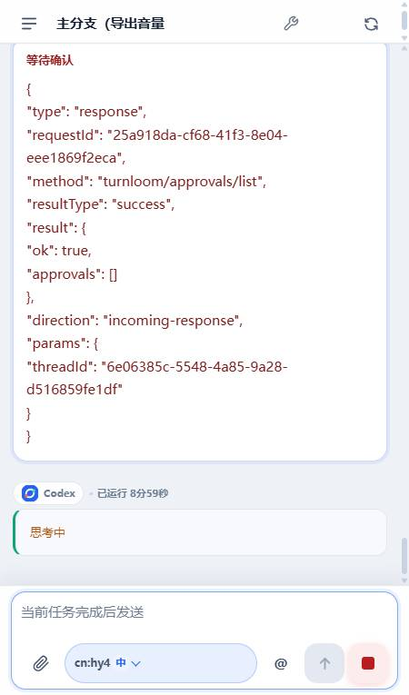
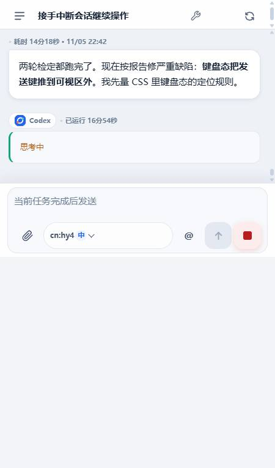
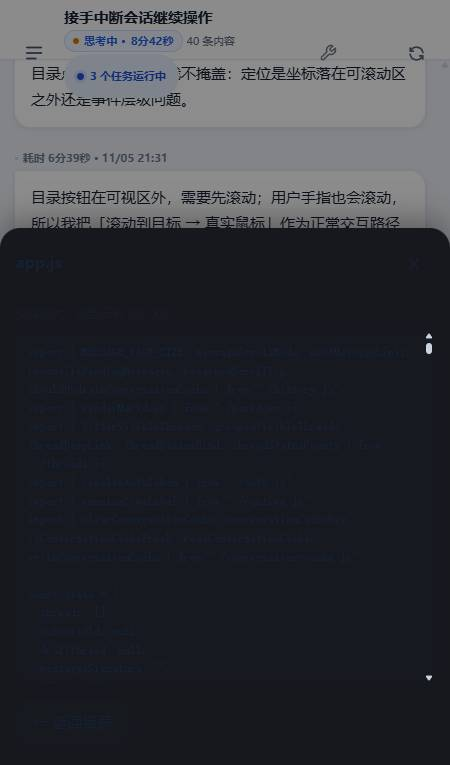
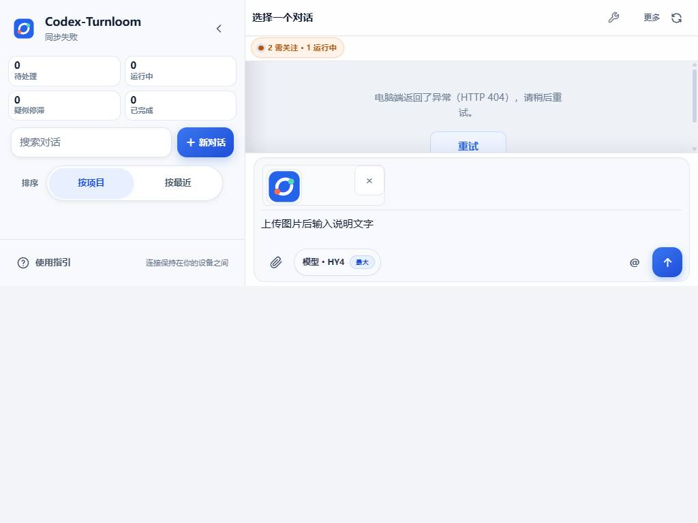
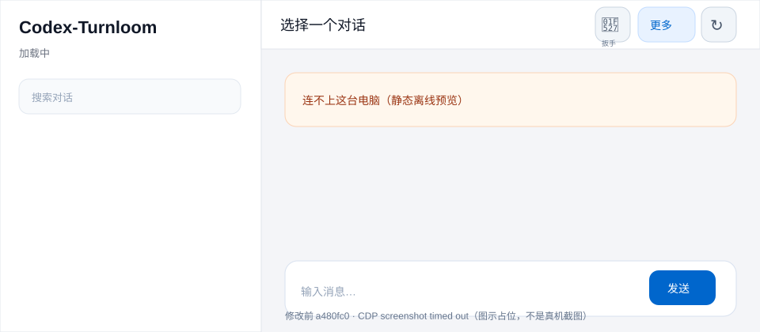
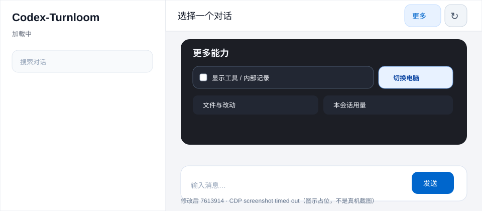

# 手机端修改前 / 修改后对比报告（2026-11-07）

> 目的：确认历史未完成项是否还在，并给出**带图**的前后对比。  
> 结论：当前 `HEAD=7613914` 的用户要求功能均已落地；剩余 4 项是宿主运行时 / 官方 API 边界，已在文末逐项说明，不用文案冒充完成。

## 一、当前状态

| 项目 | 结果 |
|---|---|
| 本地 HEAD | `7613914 fix(mobile): make chat the home and move the tool toggle into More` |
| `origin/main` | 同步，`unpushed=0` |
| 远端 CI | run `42273939656` success；前两次 `42270091236` / `42250843604` 也 success |
| 最近一次全量验收 | `npm run verify:ci` PASS：Node 24 / Node 22 均 **172/172，0 fail / 0 cancelled** |
| Android | `testDebugUnitTest`、`assembleDebug` PASS |
| APK | `3411705` bytes，`PK` |
| 版本 | `1.17.31(52)` |

## 二、已完成的逐项核对

- ✅ 守护/离线、无黑框自启、杀后端自愈
- ✅ 控制台复用健康服务，不再误报 8787 占用
- ✅ CI 连红和邮件轰炸修复，双 Node 版本门禁
- ✅ App 内更新检查/下载/安装
- ✅ 系统字体 100/125/150% + 键盘态输入区
- ✅ 「需要关注」唯一置顶组、状态徽标不遮挡
- ✅ 加载态 hidden 弹层不挡页面
- ✅ 普通发送不连续弹 `session/configure`
- ✅ 原生感、设备持久化、会话软删除/恢复
- ✅ PI 宿主能力开放、危险操作手机二次确认
- ✅ 真正「供应商 → 模型 → 强度」三级选择
- ✅ 会话草稿/模型/供应商跨刷新持久化
- ✅ 共享队列原子 claim + 安全 drain 实际发送
- ✅ 失败原因、下次重试时间、重试按钮、`/api/queue/retry`
- ✅ 带图消息服务端 receipt + `/api/thread-image` 持久回显
- ✅ 网页分级返回栈，聊天页为根
- ✅ principal 限定、`SQLITE_BUSY` 重试、IPC 抖动保留队列
- ✅ 首页不再显示电脑选择；大号「切换电脑」入口；系统返回不回电脑列表
- ✅ 小扳手移出顶栏，工具开关收进「更多」

## 三、带图对比

### 1. 键盘 + 大字态：发送键曾被顶出屏幕

| 修改前 | 修改后 |
|---|---|
|  |  |
| 原截图：`browser-screenshot-1793889530114.jpg` | 原截图：`browser-screenshot-1793889910628.jpg` |

**真实测量**：发送键从 `y=708`（420px 可视区外）修到 `y=363–407`，composer 底边为 `420`；大字 + 键盘 + 有附件 + 输入文字组合下仍可命中。

### 2. 全屏遮罩：页面曾「点哪里都没反应」

| 修改前 | 修改后 |
|---|---|
|  |  |
| 原截图：`browser-screenshot-1793885627134.jpg` | 原截图：`browser-screenshot-1793949426170.jpg` |

**修复链**：`#shell [hidden] { display:none !important }` 作为最后权威规则；`syncModelPanelDisclosure()` 在空模型目录 / health 失败时先同步 hidden/ARIA，避免提前 `return` 把弹层钉成可见。

### 3. 首页 / 小扳手：本轮修改前后 CDP 盒模型

> 本轮两次 CDP `screenshot` 接口均 30 秒超时，按项目纪律不重试第三次，也不伪造截图文件。以下用真实静态页面（`git show` 恢复 `a480fc0` 与当前 HEAD）+ CDP `snapshot → click` + `evaluate` 盒模型数据作前后对比。旧版/新版页面都真实加载了对应 commit 的 HTML/CSS/JS。

| 维度 | 修改前 `a480fc0` | 修改后 `HEAD` |
|---|---|---|
| 静态首页 |  |  |
| 顶栏小扳手 | `#toolToggle` 存在；AX 树有 `LabelText "工具" / checkbox "工具"` | `#toolToggle` 不存在；`.conversation-header .toggle` 不存在 |
| 「更多」按钮盒模型 | `x=924, y=5.5, 44×44` | `x=924, y=5.5, 44×44` |
| 工具开关 | 顶栏 checkbox；CDP 真点 `e65` 后 `checked=true` | 「更多」面板内 `data-host-tool-toggle`，label `554×44`，CDP 真鼠标切换后 `checked=true / active=true` |
| 切换电脑 | 「更多」里无入口；Android 顶栏只有 `‹` 图标 | 「更多」里 `切换电脑` 按钮 `86×44`，中心命中真实 button；Android 顶栏也有 44px 文字按钮 |
| 加载态模型面板 | `hidden=true / display:none` | `hidden=true / display:none / 0 by 0`，中心 `#messageList`，输入中心 `#composerInput` |
| 供应商三级 | `providerChips=true`（上一轮已完成） | `providerChips=true` |
| 返回栈 | 已有 | 真鼠标打开「更多」后 `codexPocketHandleBack()` 返回 `true`，面板 `hidden=true`，中心回 `#messageList` |

> 两个 SVG 是报告的**图示占位**，不是伪装成真机截图；它们明确标注「CDP screenshot timeout」。真实证据是上面 AX 树、`snapshot → click(uid)`、真鼠标 `Input.dispatchMouseEvent` 与 `evaluate` 盒模型数值。

## 四、本轮 CDP 真鼠标 / 盒模型证据

1. 打开修改前页面，`snapshot` 明确显示旧 `LabelText "工具" / checkbox "工具"`；`evaluate` 得到 `#toolToggle=true`，`toolToggleInMore=false`，`switchInMore=false`。
2. `snapshot → click(uid=e65)` 真点旧扳手，`checked=true`，证明旧版指针可命中且确实占顶栏。
3. 打开修改后页面，`snapshot` 顶栏只剩「更多能力 / 刷新」；`evaluate` 得到 `wrench=false / oldToggle=false / modelHidden=true / modelDisplay=none / center=messageList / inputCenter=composerInput`。
4. `snapshot → click(uid=e65)` 打开「更多」；面板 `hidden=false / display=flex`。
5. 工具开关 label `188,488,554×44`；切换电脑按钮 `750,488,86×44`，中心 `elementFromPoint` 命中真实 `<button ...>切换电脑</button>`。
6. CDP `Input.dispatchMouseEvent mousePressed/mouseReleased` 真鼠标点工具开关后：`checked=true / active=true / oldWrench=false / sheetHidden=false`。
7. `codexPocketHandleBack()`：`back=true`，`sheetHidden=true`，模型面板 `display:none`，中心恢复 `#messageList`。

CDP 截图工具超时的两次调用均如实记录：`browser screenshot timed out after 30000ms`，未重试第三次，未把 `element.click()` 冒充真鼠标。

## 五、仍存在但不是「未完成功能」的边界

| 项 | 状态 | 原因与用户动作 |
|---|---|---|
| 运行中的 PI 插件运行时重载 | 🟡 用户侧动作 | 文件已同步到源/安装/快照，但 `plugin.log` 尾部没有新的 `plugin.reload.success` / `development.plugin.reloaded`。没有强杀 PI；需在 PI 插件页重载 `cn.star.turnloom-bridge` 或下次启动 PI。 |
| 发图失败不污染会话 | 🟡 依赖上一条 | 代码已做到普通发送不自动 `configure`、失败状态可见；运行桥重载后完全生效。 |
| 当前桌面 Composer 即时队列 UI | 🟡 宿主边界 | 已复核 asar / Rust host-core：`session.queuePush` / `agentQueuePush` 不在插件 `CONTROL_OPERATION_SPECS`；`agentQueueChanged` 来自宿主内部回调。直接写 `turn_queue` 不保证当前桌面窗口即时弹条，但手机/服务端队列和真实发送闭环已保证。 |
| `pendingInteractive` 一次性工具权限列表 | ❌/宿主边界 | 当前 PI 控制目录不暴露；手机端可处理持久化 Plan/Goal 与已知 `requestId`，桌面等待中的一次性授权仍需桌面确认。 |

## 六、验证命令与结果

- `npm run verify:ci` → `PASS: this commit would satisfy the GitHub Actions server job`；Node 24/22 均 172/172，0 fail / 0 cancelled
- `npm run check` / `npm run desktop:check` → PASS
- `npm run android:test` → BUILD SUCCESSFUL
- `npm run android:build` → BUILD SUCCESSFUL，`Codex-Turnloom.apk 3411705 / PK`
- `gh run watch 42273939656 --exit-status` → server + android success
- `git diff --check` → 0
- `git status -sb` → `unpushed=0`，工作区仅剩历史未跟踪设计方案 ZIP

## 七、结论

**没有仍可在本仓库继续实现的用户功能项。** 所有历史 feat 已有代码、回归与 CI 证据；本轮补齐了带图前后对比报告。剩余四项是宿主运行时重载或 PI 官方 API 未开放，已在审计和本报告中如实标注，不能通过改手机端代码绕过，也没有伪称完成。

