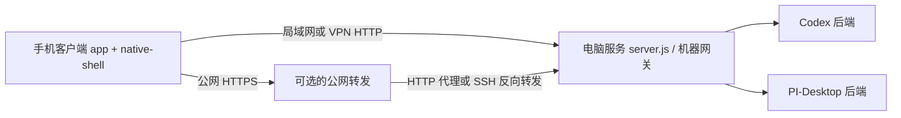

# 客户端、电脑服务与公网转发

Turnloom 的三端通过 HTTP API 连接，各自可以单独配置和替换。



| 模块 | 职责 | 不应依赖 |
|---|---|---|
| 手机客户端 | 本地界面、配对入口、请求鉴权、会话显示 | SSH 密钥、服务器上的路径、固定公网 IP |
| 电脑服务 | `/api/*`、机器发现、harness 路由、附件暂存 | 公网转发是否在线 |
| 公网转发 | 将可用的网络入口转发到电脑服务 | 手机 UI、模型目录和会话数据库 |

## 三种访问方式

桌面控制台 → 设置 → 访问方式与公网转发：

- **局域网 / VPN 直连**：客户端使用本机局域网地址。旧公网 URL 保留在配置里但不会进入二维码，也不会触发公网健康检查或 SSH 启动。VPN 应提供可路由到本机的地址；自动二维码默认使用系统检测到的 LAN 地址，必要时在客户端手动填写 VPN 地址。
- **外部 HTTPS 代理**：填写已经部署的 HTTPS 入口，例如 Caddy、Nginx、Cloudflare Tunnel 或现有反向代理。本控制台不管理这些外部进程，不要求 SSH 密钥。代理应完整保留 `/api/*`、`/__turnloom/health`、请求体和 `x-access-token`。
- **SSH 反向隧道**：电脑主动连接转发服务器，使用本地密钥和 known_hosts，远端监听在 loopback，由服务器上的 HTTPS 代理接入。SSH 确认远端转发成功只证明 SSH 通道，公网 HTTP 健康须独立检查。

公网服务器故障时可先切到直连，在同一局域网继续使用。外网访问需要恢复原服务器或提供另一个有效入口，客户端本身无法替代失效的中转网络。

## 配置与兼容

控制台增加 `network.mode`，取值 `direct`、`external`、`ssh`。没有这个字段的旧配置保持原有语义：启用 SSH 则为 ssh，有公网地址则为 external，否则 direct。显式选定模式后，`publicUrl` 是客户端入口的真源，不再被旧 `machineGateway.origin` 覆盖。

```json
{
  "host": "0.0.0.0",
  "port": 8787,
  "network": { "mode": "direct" },
  "publicUrl": "https://gateway.example.com",
  "tunnel": { "enabled": false }
}
```

多服务机器使用 `machineGateway.machineConfigPath` 指向的 `machine.json` 管理机器标识、机器访问码和 Codex/PI 后端。控制台禁用与该模式不对应的单后端数据目录和访问码控件，并显示配置来源，防止修改无效字段。

## 变更与状态隔离

- 外观、日志选项或客户端入口 URL 修改：不重启电脑服务。
- 转发模式或 SSH 参数修改：只调整转发模块。
- 本机监听端口等服务参数修改：先停自有转发、重启服务，服务成功后再启动转发。
- 控制台复用的外部守护进程保持原有所有权规则，退出控制台不会杀掉它们。若外部守护已运行，应由该守护应用新的转发配置。
- Runtime snapshot 的 `topology.server` 与 `topology.relay` 分别记录状态；总状态“部分可用”不意味着本地服务离线。

## 验证

运行 `node --test test/desktop-transport.test.cjs test/desktop-console-reuse.test.cjs` 验证改转发不重启服务、旧配置兼容、直连忽略旧公网、外部代理不要求密钥、SSH 事件和所有权边界。运行 `npm run verify:ci` 验证 Node 当前版本和 Node 22。

发布前必须从 Git 的干净检出运行测试。`docs/option-a/SINGLE_APP_CONTRACT.md` 是被测试读取的公开合同，必须纳入版本控制；本机私有 AGENTS.md 不应作为 CI 输入。
